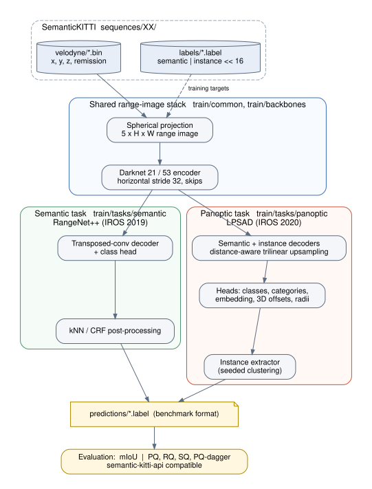
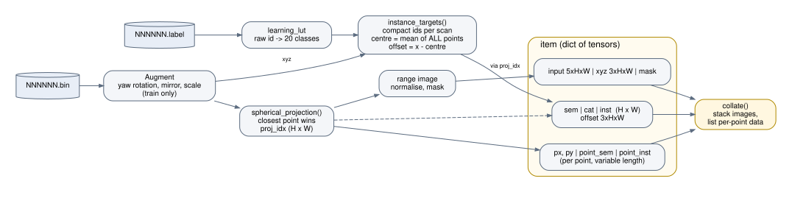
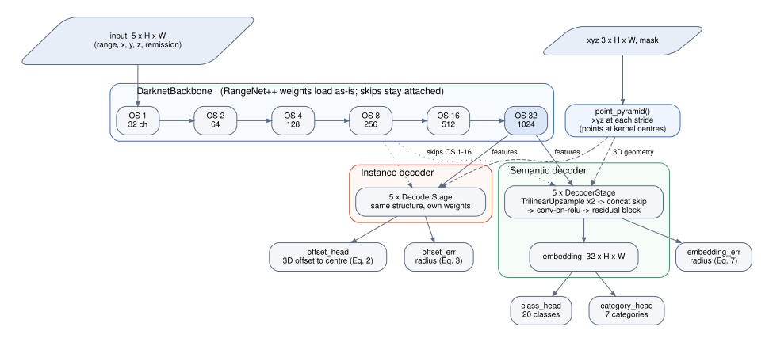
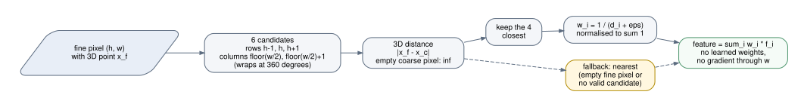
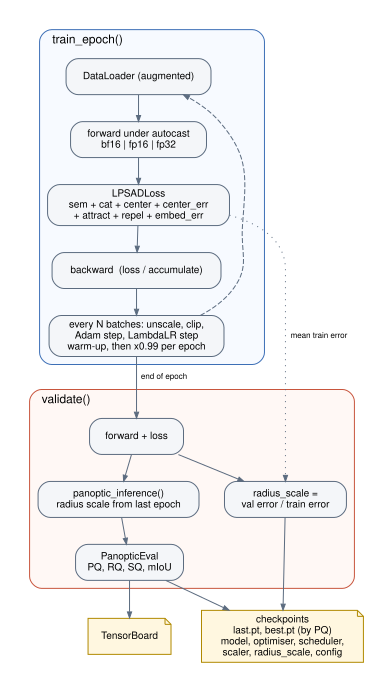
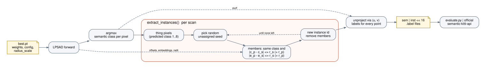

# Architecture

This page describes the system and each subsystem: what it does, its inputs and
outputs, and where the code lives. Design rationale is in
[design-decisions.md](design-decisions.md). Diagrams are generated from the
Graphviz sources in [diagrams/](diagrams) (see [development.md](development.md#diagrams)).

## System overview

The repository is one shared range-image stack with two tasks on top.

| Layer | Location | Responsibility |
|---|---|---|
| Data | SemanticKITTI `sequences/XX/{velodyne,labels}` | Raw scans (`float32` x, y, z, remission) and labels (`uint32`: semantic id in the low 16 bits, instance id in the high 16 bits). |
| Shared stack | `train/common`, `train/backbones` | Spherical projection, scan I/O, logging; SqueezeSeg and Darknet encoders. Encoders downsample only horizontally (64 rows are too few to lose). |
| Semantic task | `train/tasks/semantic` | Upstream RangeNet++: encoder, transposed-conv decoder, class head, kNN/CRF post-processing. Kept as is apart from portability fixes. |
| Panoptic task | `train/tasks/panoptic` | LPSAD: self-contained package `lpsad/` and three entry points (`train.py`, `infer.py`, `evaluate.py`). |
| Output | `predictions/*.label` | Same binary format as the ground truth, so the official [semantic-kitti-api](https://github.com/PRBonn/semantic-kitti-api) and benchmark accept it. |

**Boundaries.** The panoptic task depends on the shared stack only through
`backbones/darknet.py` (`Backbone`, `BasicBlock`). It has its own projection and
dataset code, and it never imports from `tasks/semantic`, so either task can
change without breaking the other. The tasks exchange data only through files:
a RangeNet++ model directory (its `backbone` state dict initialises the
panoptic encoder) and `.label` files.

### Panoptic package structure

| Module | Responsibility | Depends on |
|---|---|---|
| `lpsad/config.py` | Load YAML; build the `LabelSpace` (class maps, things, categories, frequencies) | – |
| `lpsad/dataset.py` | Scan → range image and training targets; `collate` | config |
| `lpsad/model.py` | Network: backbone wrapper, point pyramid, trilinear upsampling, decoders, heads | `backbones.darknet` |
| `lpsad/losses.py` | Eqs. 2–7 and the category loss | config |
| `lpsad/cluster.py` | Instance extractor and per-point panoptic output | – |
| `lpsad/metrics.py` | Point-level PQ / RQ / SQ / PQ† / mIoU | – |
| `lpsad/trainer.py` | Optimisation loop, validation, checkpoints | all of the above |
| `train.py`, `infer.py`, `evaluate.py` | Command-line entry points | the package |

`model.py`, `cluster.py` and `metrics.py` don't know about files or configs
beyond plain dictionaries, so they can be tested in isolation, and are.

## Subsystem: data pipeline

`SemanticKittiPanoptic.__getitem__` turns one scan into training tensors.

1. **Read** the `.bin` scan and, with ground truth, the `.label` file. Raw
   semantic ids map to 20 training classes through `learning_lut`
   (`learning_map` in the label config).
2. **Augment** (training only): random yaw rotation, mirroring across the x
   axis, and scaling, applied to the 3D points *before* projection. That way
   occlusion in the range image stays physically consistent.
3. **Instance targets** (`instance_targets`): thing points with a non-zero
   instance id get compact per-scan ids `1..K`. Each instance's centre is the
   mean of all its points in the full cloud, and the target is the offset
   `x - centre`.
4. **Project** (`spherical_projection`, paper Eq. 1) to `H x W`. Points are
   written far to near, so each pixel keeps its closest point. `proj_idx`
   records which point owns each pixel (`-1` if empty).
5. **Assemble** the image tensors (normalised input, raw `xyz`, mask, class,
   category, instance, offset) and the per-point tensors (`px`, `py` and
   point-level labels, variable length per scan). `collate` stacks the images
   and keeps the per-point data as lists.

**Contract.** All image tensors are `H x W` with `mask == False` on empty
pixels. Empty pixels are zero in `input` and unlabeled (class 0) in `sem`.
Point-level data is in the original point order, so `(px, py)` maps every
point, including occluded ones, to a pixel.

## Subsystem: network

- **Encoder** (`DarknetBackbone`): the RangeNet++ Darknet with unchanged
  parameter names, so RangeNet++ checkpoints load directly
  (`LPSAD.load_rangenet_backbone`). It differs from upstream in one way: the
  skip connections are not detached, so the decoder losses reach the early
  layers through them (upstream detached them).
- **Point cloud pyramid** (`point_pyramid`): for every horizontal stride-2
  layer, keep the 3D point at each kernel centre (`xyz[..., ::2]`). The decoders
  use it to upsample by real 3D distance.
- **Decoders** (`Decoder`, `DecoderStage`): two decoders with the same
  structure and separate weights. Each stage upsamples x2, concatenates the
  encoder skip, then applies conv-BN-LeakyReLU and a Darknet residual block.
  `upsample: transpose` swaps in RangeNet++'s transposed convolutions, for the
  paper's Table III ablation.
- **Heads**: the semantic decoder produces a 32-d embedding, which feeds the
  class head (20) and the category head (7). Error heads (three conv blocks
  and a softplus) predict the per-pixel *radius* for embeddings and for offsets.
  The instance decoder predicts the 3D offset to the instance centre.

### Distance-aware trilinear upsampling

`TrilinearUpsample` replaces learned or bilinear upsampling (paper Sec. III-C,
Fig. 4). For every fine pixel it takes 6 candidate coarse pixels: the two
columns that bracket it, in three rows. It keeps the 4 closest in 3D and blends
their features with normalised inverse-distance weights. Neighbours across a
depth discontinuity (a car in front of a wall) are far apart in 3D, so features
don't bleed across object borders the way they do with 2D interpolation. The
weights depend only on geometry: there are no parameters, and no gradient
flows through the weights. The range image wraps around at 360°. Empty fine
pixels, and fine pixels without a valid candidate, fall back to
nearest-neighbour upsampling.

## Subsystem: training

`Trainer.fit` runs `train_epoch` and `validate` once per epoch.

- **Losses** (`LPSADLoss`), summed with configurable weights:
  - semantic cross-entropy with class weights `1/ln(1.02 + f_c)` (Eq. 4);
  - category cross-entropy;
  - offset L2, averaged per instance (Eq. 2);
  - offset-radius regression to the detached offset error (Eq. 3);
  - attract / repel embedding losses within each scan (Eqs. 5–6);
  - embedding-radius regression (Eq. 7).
- **Optimisation**: Adam (1e-4, betas 0.9/0.99), linear warm-up for one epoch,
  then x0.99 per epoch, as in the paper. Gradient accumulation and clipping.
  `autocast` in bf16 or fp16 (with `GradScaler`). Optional `torch.compile`.
- **Fine-tuning controls**: start from RangeNet++ weights, freeze the backbone
  for the first N epochs, freeze backbone BatchNorm statistics for small
  batches.
- **Radius scale**: the learned radii come from training error, which
  underestimates test error. As in the paper, they're multiplied by
  `val error / train error`, measured each validation and stored in the
  checkpoint. Validation clusters with the previous epoch's scale, so it lags
  by one epoch.
- **Checkpoints**: `last.pt` every epoch and `best.pt` by validation PQ. They
  hold model, optimiser, scheduler, scaler, epoch, radius scale and the full
  config, so `infer.py` needs nothing else.

## Subsystem: inference and instance extraction

`panoptic_inference` turns network outputs into per-point labels.

1. Take the semantic class per pixel as `argmax` of the class logits.
2. Run `extract_instances` per scan over thing pixels. Pick a random
   unassigned seed. Every unassigned pixel of the same class whose predicted
   centre `x - offset`, and/or embedding, lies within the radius joins its
   instance. Remove those pixels and repeat until none are left. The radius is
   the seed's (`radius_mode: seed`, paper, default) or seed plus candidate
   (`sum`, see the design decisions).
3. Unproject: every original point takes the labels of its pixel `(px, py)`
   (paper Sec. III-E).
4. `infer.py` writes `inverse_lut[class] | (instance << 16)` as `uint32`.

## Subsystem: evaluation

`PanopticEval` (`lpsad/metrics.py`) follows the logic of semantic-kitti-api's
`PanopticEval`:

- points whose ground truth is an ignored class are dropped;
- instance ids are shifted by one, so each stuff class forms one segment;
- segments match at IoU > 0.5;
- unmatched segments smaller than `min_points` (50) are not counted.

It reports PQ, PQ† (IoU in place of PQ for stuff classes), RQ, SQ, the thing and
stuff splits, mIoU and per-class values. `evaluate.py` runs it over a
predictions folder. Use the official script for numbers you publish.

## Subsystem: analysis tools (no training)

`train/tasks/panoptic/tools/` produces real SemanticKITTI numbers with no
trained model. Each tool writes JSON (`--json`).

| Tool | Answers | Needs |
|---|---|---|
| `fetch_sequences.py` | Get selected sequences, or an evenly spaced subset, plus their labels | Network; reads single files from the KITTI zip with HTTP range requests |
| `upper_bounds.py` | What the range image loses (points, instances, PQ ceiling); how accurate offsets must be; `seed` vs `sum` radius | Scans + labels |
| `baseline.py` | PQ of any semantic segmentation + `lpsad/geometric.py` Euclidean clustering; `--semantics gt` isolates clustering | Scans + labels + semantic predictions |
| `benchmark.py` | Network and clustering time per scan; peak training memory per width and batch size | Nothing (synthetic scans); a GPU for memory |
| `visualize.py` | Figures: a scan (range image, classes, instances, bird's-eye view), points kept per width, upsampling error at edges | Scans; labels or predictions for class panels |
| `report.py` | Markdown tables and charts from the JSON of the tools above | Their `--json` output |

`lpsad/geometric.py` links thing points of the same class closer than a
radius (k-d tree + connected components). This is the classic
"semantics + clustering" baseline: it can't separate touching objects of one
class, which is what LPSAD's learned offsets address.

## Configuration

One YAML file (`train/tasks/panoptic/config/lpsad-darknet53.yaml`) holds
everything: label definitions (by reference to the semantic task's label file),
panoptic things and categories, sensor, model, loss weights, clustering and
training. `train.py --set key.sub=value` overrides any value, and
`infer.py --cluster key=value` changes clustering without retraining. Every
checkpoint embeds the resolved config.
