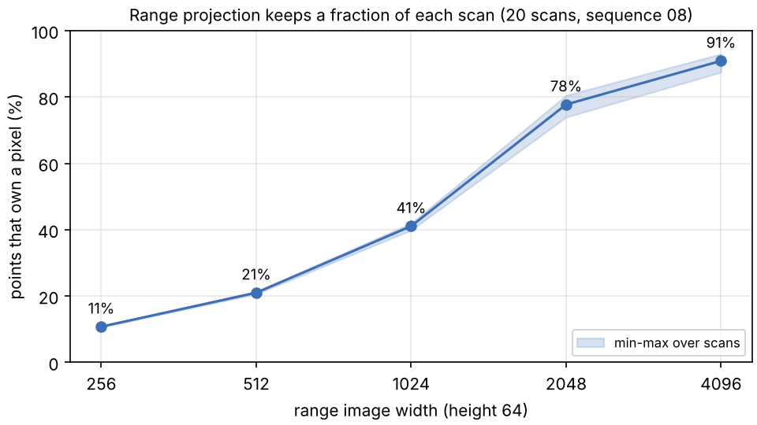
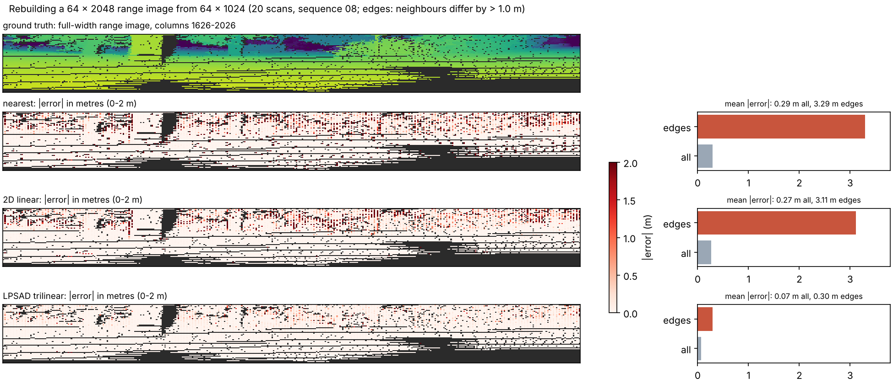
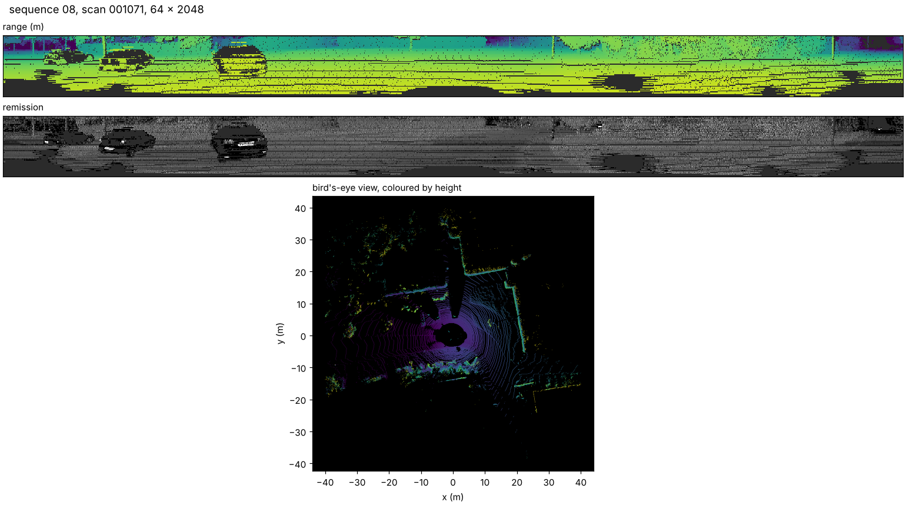

# Figures

Images and tables for the README and slides. Every figure here comes from
real KITTI scans and can be regenerated with the command shown. Figures that
need labels or a trained model (classes, instances, PQ) are produced with the
same tools once that data is available; see
[Real numbers without training](../../train/tasks/panoptic/README.md#real-numbers-without-training).

Data for all three: 20 evenly spaced scans of sequence 08, fetched with

```sh
python tools/fetch_sequences.py -o /data/kitti -s 08 --max-scans 20 --labels none
```

(commands run from `train/tasks/panoptic`; dataset root `/data/kitti/dataset`).

## Points kept by the range projection



```sh
python tools/visualize.py projection -d /data/kitti/dataset -s 08 -o projection.png
```

| Width | Points kept (mean) | min | max |
|---|---|---|---|
| 64 x 256 | 10.8% | 10.6% | 11.0% |
| 64 x 512 | 21.0% | 20.6% | 21.3% |
| 64 x 1024 | 41.1% | 39.8% | 42.0% |
| 64 x 2048 | 77.7% | 73.9% | 80.5% |
| 64 x 4096 | 90.9% | 87.5% | 93.0% |

**Takeaway.** Each pixel keeps only its closest point, so a 64 x 1024 image
holds 41% of a scan's points and 64 x 2048 holds 78%. Every range-image
method labels the remaining points by copying from their pixel (or by kNN),
which is one reason resolution matters so much.

## Distance-aware vs 2D upsampling at object edges



```sh
python tools/visualize.py upsampling -d /data/kitti/dataset -s 08 -o upsampling.png
```

| Upsampling | Mean abs. error, all (m) | at object edges (m) |
|---|---|---|
| nearest | 0.290 | 3.293 |
| 2D linear | 0.266 | 3.113 |
| LPSAD trilinear | 0.066 | 0.296 |

The full-width range image is rebuilt from every second column. An "edge" is
an interpolated pixel whose two coarse neighbours differ by more than 1 m.

**Takeaway.** 2D interpolation averages the foreground and the background at
an object's border (errors of metres). LPSAD's upsampling takes values from
the coarse points closest in 3D, so they come from the same surface.

**Caveat.** Range is itself geometric, so choosing neighbours by 3D distance
favours it almost by construction. The figure shows that the method picks
same-surface neighbours. For learned features, the benefit is that a pixel on
a car gets car features, not features of the wall behind it. The paper
measures that effect on panoptic quality: 30.8 → 36.5 PQ (Table III).

## A scan as the network sees it



```sh
python tools/visualize.py scan -d /data/kitti/dataset -s 08 --index 5 --dpi 110 -o scan-08-001071.png
```

Range and remission channels of the 64 x 2048 input, and a bird's-eye view.
With labels (and `-p predictions`), the same command adds ground-truth and
predicted class and instance panels.

## Tables and charts from your runs

`tools/report.py` turns the JSON of `upper_bounds.py`, `baseline.py` and
`benchmark.py` into Markdown tables and charts (clustering vs offset
accuracy, latency vs width, training memory vs batch size):

```sh
python tools/report.py bounds.json baseline.json bench.json -o report
```
